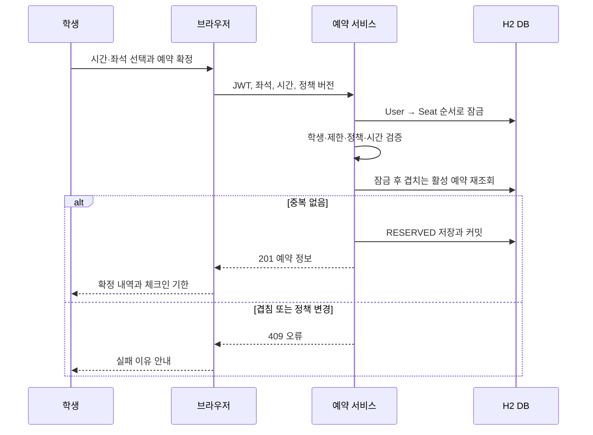

# Sprint 1 구현 구조와 API

## 사용자가 누른 버튼이 실제로 처리되는 과정

브라우저는 Thymeleaf가 제공한 HTML과 로컬 JavaScript를 사용합니다. 로그인하면 서버가 JWT를 발급하고, 이후 요청은 `Authorization: Bearer …`로 전달합니다. 서버는 토큰 서명·발급자·만료를 검사한 뒤 DB의 활성 계정과 현재 역할을 다시 확인합니다. 화면을 바꿔 관리자 버튼을 노출해도 서버 권한 검사를 통과할 수 없습니다.

Controller는 입력 형식과 HTTP 응답을 다루고, Service는 정책·소유권·시간·상태를 검증합니다. Repository는 DB 조회와 잠금을 담당합니다. JPA는 Flyway로 만든 스키마를 검증하며 DB 구조를 임의로 자동 변경하지 않습니다.

| 위치 | 책임 |
|---|---|
| `web/` | API, 요청/응답 DTO, 화면 경로, 공통 오류 응답 |
| `service/` | 가입·인증, 예약, 좌석 조회, 정책, QR 체크인 |
| `domain/` | 사용자·인증 토큰·좌석·예약·정책 버전과 상태 전이 |
| `repository/` | DB 접근, 겹침 조회, 비관적 쓰기 잠금 |
| `config/` | JWT/보안, 시각, 비밀번호 해시, 키 관리, 초기 좌석 |
| `resources/templates/` | 학생·관리자·메일 인증 화면 |
| `resources/static/` | CSS, JavaScript, 로컬 QR 판독 라이브러리 |
| `db/migration/` | 테이블·외래 키·고유 제약·인덱스 |

## 핵심 흐름: 예약



예약 시간은 한국 시간 기준 같은 날짜의 30분 경계이며 `시작 < 종료`여야 합니다. 구간은 `[시작, 종료)`라서 10:00–11:00과 11:00–12:00은 겹치지 않습니다. 유효한 예약의 상태는 `RESERVED`, 체크인 후 `CHECKED_IN`, 조기 퇴실 후 `COMPLETED`입니다. `AUTO_CANCELLED`는 향후 스케줄러 연동을 위해 정의되어 있고 체크인 대상에서 제외됩니다.

동시성 방지는 ‘중복을 조회하고 저장’만으로 해결하지 않습니다. 사용자 행을 먼저 잠그면 한 학생의 여러 좌석 요청이 순서대로 처리됩니다. 이어 좌석 행을 잠그면 여러 학생의 같은 좌석 요청이 순서대로 처리됩니다. **두 잠금을 얻은 다음** 겹침을 재조회하고 저장하므로 먼저 대기하던 요청이 직전 확정 예약을 확인합니다. DB 격리는 `READ_COMMITTED`입니다.

체크인·퇴실은 `User → Seat → Reservation` 순서로 잠급니다. 소유자/좌석 식별자는 엔티티를 미리 로딩하지 않는 스칼라 조회로 얻어 대기 이전의 낡은 상태가 JPA 캐시에 남지 않게 합니다. 퇴실과 중복 체크인이 동시에 도착해도 완료 예약이 다시 사용 중으로 되살아나지 않습니다. 미래 Sprint 2 작업도 같은 잠금 순서를 따라야 합니다.

## 핵심 흐름: QR 체크인과 퇴실

1. 관리자는 해당 좌석의 QR PNG를 내려받습니다. QR에는 버전·좌석 코드·추측하기 어려운 좌석별 토큰이 들어갑니다.
2. 브라우저의 jsQR이 카메라 영상 또는 이미지에서 QR을 읽습니다. 다른 좌석 코드이면 먼저 안내합니다.
3. 서버는 클라이언트의 안내 여부와 관계없이 예약 소유자, 좌석 토큰 해시, 예약 상태, 시작/기한/종료 시각을 다시 검증합니다.
4. 시작부터 시작+유예시간까지, 종료 전이면 `CHECKED_IN`으로 전환합니다. 같은 올바른 QR의 재요청은 동일한 완료 결과를 돌려줍니다.
5. 본인 `CHECKED_IN` 예약에 대한 퇴실만 `COMPLETED`로 바뀝니다. 원래 종료 시각은 보존하고 `completed_at`에 실제 퇴실 시각을 기록합니다. 활성 겹침 조회에서 제외되어 남은 시간대를 다른 학생이 예약할 수 있습니다.

DB에는 QR 토큰 원문 대신 SHA-256 해시를 저장합니다. QR 재발급용 원문은 영속 서명 키와 좌석 코드의 HMAC에서 안정적으로 재생성합니다. 키를 잃으면 기존 DB의 QR을 재생성할 수 없으므로 시작 시 키 일치도 검사합니다. 이메일 인증 토큰 역시 랜덤 생성 후 DB에는 해시만 저장합니다. 인증 링크를 실제 사용자에게 전달하는 SMTP 메일 또는 개발용 로컬 메일 파일에는 링크 원문이 포함됩니다.

## 데이터와 정책 버전

| 테이블 | 핵심 정보 |
|---|---|
| `app_user` | 이메일·학번 고유, BCrypt 비밀번호, 역할, 인증 상태, 제한 종료 시각 |
| `email_verification` | 사용자 FK, 토큰 해시 고유, 발급·만료·소비 시각 |
| `seat` | A01–H06 48석, 열람실 구역, QR 토큰 해시 |
| `policy_version` | 정책 버전, NORMAL/EXAM, 최대 시간·단위·입실 유예 등 |
| `reservation` | 사용자·좌석·정책 FK, 시작/종료/예약 시각, 체크인 기한, 상태 |

기본 정책은 DB에 분리되어 있습니다. `NORMAL=240분`, `EXAM=180분`, 예약 단위 30분, 입실 유예 15분입니다. 운영 기간 변경은 기존 행을 덮어쓰지 않고 새 정책 버전을 만듭니다. 예약은 생성 당시 정책과 계산한 입실 기한을 보존합니다. 학생은 조회 당시의 `policyVersion`을 예약 요청에 보내며 그 사이 정책이 바뀌면 새로 조회하도록 409를 받습니다.

화면의 실시간 현황은 5초 폴링입니다. WebSocket은 사용하지 않습니다. 활성 예약의 겹침을 한 번에 조회해 좌석별로 분류하며, 다른 학생의 이름·이메일·예약 ID는 좌석 응답에 노출하지 않습니다. 조회 실패 시 가용 좌석 수를 ‘—’로 바꾸고 예약을 비활성화합니다.

## API 계약

기본 경로는 `http://localhost:8080`입니다. 공개 API 외에는 Bearer JWT가 필요합니다. 모든 시각 입력은 오프셋을 포함한 ISO 8601이며 응답 Instant는 UTC `Z` 형식입니다. 화면에서는 한국 시간으로 표시합니다.

| Method / 경로 | 입력 | 성공 | 권한/비고 |
|---|---|---|---|
| POST `/api/users` | studentNo, email, password, requestedRole | 201 사용자·deliveryStatus | 공개, 관리자 이메일 허용 목록 검증 |
| POST `/api/email-verifications` | token | 200 ACTIVE 사용자 | 공개, 단일 사용 |
| POST `/api/email-verifications/resend` | email | 200 안내 | 공개, 60초 재발송 간격 |
| POST `/api/auth/tokens` | identifier, password | 200 accessToken·expiresAt·user | 이메일/학번 로그인 |
| GET `/api/me` | — | 200 사용자 | 인증 계정 |
| GET `/api/seats` | date=YYYY-MM-DD, start=HH:mm, end=HH:mm | 200 seats·availableCount·policy·serverTime | 인증 계정 |
| GET `/api/policies/current` | — | 200 현재 정책 | 인증 계정 |
| POST `/api/reservations` | seatId, startAt, endAt, policyVersion | 201 예약 | 인증 학생 |
| GET `/api/me/reservations` | — | 200 본인 예약 배열 | 인증 계정, 본인 자료만 |
| GET `/api/reservations/{id}` | — | 200 예약 | 본인 |
| POST `/api/reservations/{id}/check-ins` | qrToken | 200 예약 | 본인 학생, 기한/상태 검증 |
| POST `/api/reservations/{id}/check-outs` | 본문 없음 | 200 예약 | 본인 학생, CHECKED_IN만 |
| GET `/api/admin/policies` | — | 200 현재 정책 | 관리자 |
| PUT `/api/admin/policies` | mode, versionNo | 200 새 정책 | 관리자, 기간 전환만 |
| GET `/api/admin/seats` | — | 200 좌석 배열 | 관리자, QR 선택용 |
| GET `/api/admin/seats/{id}/qr.png` | — | 200 PNG | 관리자, 캐시 금지 |
| GET `/api/app-info` | — | 200 서버 시각·시연 여부 | 공개 |
| GET `/api/dev/mailbox` | 선택 email | 200 메일 배열 | local/demo 파일 메일 모드·루프백만 |

예시 예약 본문:

```json
{
  "seatId": 15,
  "startAt": "2026-11-14T10:00:00+09:00",
  "endAt": "2026-11-14T11:00:00+09:00",
  "policyVersion": 1
}
```

좌석 ID는 응답을 기준으로 사용하세요. C03은 최초 초기화 시 보통 15이지만 클라이언트가 고정 ID에 의존하지 않습니다. 오류는 `code`, `message`, `fieldErrors`, `details`, `requestId`를 갖습니다. 잘못된 입력 400, 미인증 401, 권한 403, 없음 404, 중복/상태/정책 충돌 409, 재발송 간격 429, 재발송 SMTP 장애 503을 구분합니다. 가입의 SMTP 실패는 계정이 이미 생성되었기 때문에 201과 `deliveryStatus=FAILED`로 반환합니다.

Sprint 2의 연장 API와 스케줄러는 구현하지 않았습니다. 아키텍처 원본의 전체 정책 PUT 계약도 Sprint 1에서는 `mode/versionNo`만 지원하며, 아직 지원하지 않는 숫자 필드를 보내면 400을 반환합니다.
